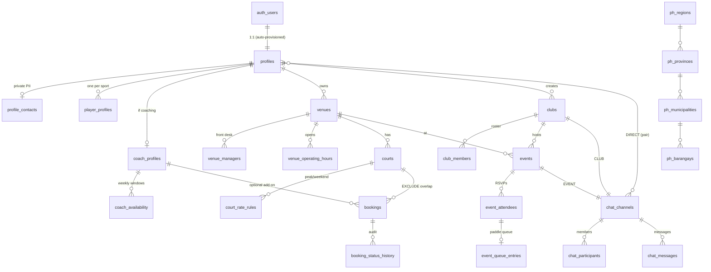

# RacketHub · Step 1 · Database architecture

> PostgreSQL / Supabase schema for courts, bookings, clubs, events and the
> 3-tier chat. Everything here is enforced **in the database**, so every
> client (Next.js, Flutter, Edge Functions, the SQL editor) gets the same
> guarantees.

| | |
|---|---|
| Migrations | `supabase/migrations/` (11 files, applied in order) |
| Tables | 25: the 13 specified plus 12 supporting tables (listed below) |
| Integrity | 4 GiST exclusion constraints, 108 CHECK constraints, guarded state machines |
| Access | RLS on every table: 65 table policies + 20 storage policies, column-level grants |
| Verified by | `scripts/verify-db.sh`: 167 assertions, including real multi-session race tests |
| Requires | Postgres 15+ (Supabase default). `btree_gist`, `pgcrypto`, `citext`. `pg_cron` optional |

---

## 1. Entity map



### Migration layout

| File | Contents |
|---|---|
| `0100_foundation` | Extensions, the private `app` schema, all enums, `timerange` type, utilities |
| `0200_ph_locations` | PSGC Region → Province → City/Municipality → Barangay reference |
| `0300_profiles` | `profiles`, `profile_contacts`, `platform_admins`, `player_profiles`, `coach_profiles`, `coach_availability`, sign-up trigger |
| `0400_venues_courts` | `venues`, `venue_managers`, `venue_operating_hours`, `courts`, `court_rate_rules`, `quote_court_booking()` |
| `0500_bookings` | `bookings` + exclusion constraints, lifecycle guard, audit history, hold expiry, `get_court_busy_slots()` |
| `0600_clubs` | `clubs`, `club_members`, membership helpers, last-admin protection |
| `0700_events` | `events`, `event_attendees`, `event_queue_entries`, capacity/waitlist engine |
| `0800_chat` | `chat_channels`, `chat_participants`, `chat_messages`, membership sync, `get_or_create_direct_channel()` |
| `0900_rls_policies` | Every table policy in one reviewable file + privilege hardening |
| `0950_storage` | Buckets and object policies (avatars, venue/club media, receipts, chat media, credentials) |
| `0990_realtime_and_jobs` | `supabase_realtime` publication and `pg_cron` jobs (Step 4's `1100_chat_engine` takes the chat tables back out of the publication) |

---

## 2. Zero double-booking

The guarantee doesn't depend on application code. It's a constraint on the table:

```sql
time_range tstzrange generated always as (tstzrange(start_time, end_time, '[)')) stored,

constraint bookings_no_court_overlap
  exclude using gist (court_id with =, time_range with &&)
  where (booking_status <> 'CANCELLED')
```

* **Half-open ranges** `[start, end)`: 10:00–11:00 and 11:00–12:00 don't
  collide, while 10:30–11:30 does.
* **Under concurrency**, the second of two racing transactions blocks on the
  first and fails with SQLSTATE **`23P01`** (`exclusion_violation`) once the
  first commits. The API maps that to "this slot was just taken". Verified with
  24–48 parallel sessions released at the same instant: exactly **one** row
  survives every time.
* **Cancelling frees the slot** immediately (the constraint is partial).
* **Coaches** get the same protection (`bookings_no_coach_overlap`), so one
  coach can't be sold for two overlapping sessions on different courts.
* **The service role can't bypass it either.** It's a constraint, not a policy.

**Why `tstzrange`, not `tsrange`:** the columns are `timestamptz` (absolute
instants). Casting to `timestamp` depends on the session `TimeZone`, so the
cast isn't `IMMUTABLE` and can't appear in a generated column or index.
`tstzrange` is the correct, immutable `[start, end)` range for these columns.

### Stale holds

An unpaid e-wallet booking holds its slot for the venue's
`payment_window_minutes` (default 30). Expired holds are cleared two ways:

1. `pg_cron` runs `app.expire_unpaid_bookings()` every minute.
2. **Inline:** each new booking first sweeps expired holds *on its own court*,
   so correctness never depends on the cron schedule.

`get_court_busy_slots()` already treats expired holds as free.

---

## 3. Booking lifecycle

```
booking_status:  PENDING_PAYMENT ──► CONFIRMED ──► COMPLETED
                        │                 │
                        └──► CANCELLED ◄──┘          (CANCELLED / COMPLETED are terminal)

payment_status:  UNPAID ──► AWAITING_VERIFICATION ──► PAID ──► REFUNDED
                   │                 │
                   │                 └──► REJECTED ──► AWAITING_VERIFICATION (resubmit)
                   └──────────────────────────────► PAID   (cash collected / verified offline)
```

| Actor | Allowed |
|---|---|
| **Player** (booker) | Create at list price · submit a GCash/Maya ref no. + receipt · edit notes · cancel (anytime while pending, or up to `cancellation_cutoff_hours` before start once confirmed) |
| **Venue owner / front desk** | Verify → `PAID` (auto-confirms) · reject with a reason (restarts the payment window) · refund · reschedule · book walk-ins and maintenance blocks · apply discounts |
| **Everyone, incl. service role** | State machines and terminal states, CHECK invariants, both exclusion constraints |

What `app.tg_bookings_guard` enforces beyond what plain RLS can express:

* **Server-side pricing.** Player-submitted amounts are discarded and recomputed
  by `quote_court_booking()`, so the price can't be tampered with.
* **Slot rules:** 15-minute grid, the court's slot increment and min/max
  length, venue opening hours (venue-local, overnight windows supported), no
  past bookings, a 90-day horizon.
* **Payment channels:** GCash, Maya and bank transfer must be set up by the
  venue. Cash-on-court can auto-confirm (`venues.auto_confirm_cash_bookings`).
* **Fraud:** one e-wallet reference number can't pay for two bookings
  (`bookings_payment_ref_unique`). Receipts in Storage can't be overwritten or
  deleted by users.
* **Audit stamps** (`confirmed_at`, `payment_verified_by`, `cancelled_by`, …) are
  owned by the trigger, and every status or amount change is appended to
  `booking_status_history`.

### Pricing: the rate matrix

`quote_court_booking(court, start, end, coach?)` prices each 15-minute slice in
the venue's local time:

1. Find the active `court_rate_rules` matching the weekday, time window and
   validity dates. The highest `priority` wins; on a tie, the newest rule wins.
2. If no rule matches, use `courts.hourly_rate`.
3. Add `lights_fee_per_hour` for slices inside `[lights_from, lights_until)`
   (the window may wrap midnight).
4. Add the coach's hourly rate when a verified coach is attached.

Example (tested): base ₱400, weeknight peak 17:00–22:00 at ₱600, lights from
18:00 at ₱100. A Monday booking 21:30–22:30 → ₱300 + ₱200 court + ₱100 lights =
**₱600**.

---

## 4. Events, waitlist and paddle queue

* `SELECT … FOR UPDATE` on the event row serialises RSVPs **per event**. The
  seat counters live on that row, so READ COMMITTED re-reads them after the
  lock and REPEATABLE READ/SERIALIZABLE raise `40001` (retry) instead of ever
  overbooking. Tested: 24–48 parallel RSVPs for 5 seats → exactly 5
  registered, the rest waitlisted, counters equal to the actual row counts.
* **Automatic waitlisting** when full; `EVENT_FULL` when the waitlist is off or
  full.
* **Automatic FIFO promotion** when a seat frees up (cancellation, removal,
  raising `max_participants`).
* `event_queue_entries` is the live 4-in/4-out (or 2-in/2-out) rotation board.
  Coming off court increments `games_played` and sends the player to the back
  of the line. Players can toggle WAITING ↔ RESTING; only organisers assign
  courts.

## 5. Chat: three tiers, one rule

Channel membership is **derived by triggers**, never self-service:

| Type | Created | Participants |
|---|---|---|
| `CLUB` | with the club | mirrors `club_members` (leaving the club revokes history access) |
| `EVENT` | with the event | organiser, coach, attendees holding a seat. Waitlisted and cancelled players are removed. Archived 7 days after the event |
| `DIRECT` | `get_or_create_direct_channel(other)` | the pair, stored as `(low, high)` behind a unique index, so two people never end up with duplicate DM threads |

RLS on `chat_messages` is then simply "is the caller a participant" (a
primary-key lookup). Sender identity is forced to `auth.uid()`. Edits are
allowed for 15 minutes. Deletes are soft deletes that wipe the content. Club
admins and event organisers can moderate.

Step 4 ([04-chat-engine.md](04-chat-engine.md)) builds the engine on top:

* per-chat `seq`/`rev` ordering and unread markers;
* idempotent sends;
* DMs that stay private until the first message;
* blocks, reports and the media lifecycle;
* live updates as Realtime **Broadcast** hints on private topics, instead of
  Postgres Changes, whose per-subscriber RLS on every change doesn't scale
  to club-sized chats.

---

## 6. Access model (RLS)

| Table | anon | Any signed-in user | Owner / special roles |
|---|---|---|---|
| `ph_*` | read | read | service role imports |
| `profiles` | – | read | self update |
| `profile_contacts` | – | – | self; the venue you booked; your coach/student; organisers of events you joined |
| `player_profiles`, `coach_profiles`, `coach_availability` | – | read | self write. Verification by platform admins only |
| `venues`, `courts`, `court_rate_rules`, `venue_operating_hours` | read active | read active | owner writes. Front desk reads own venue |
| `bookings` | – | – (availability via `get_court_busy_slots`, which shows times only) | booker, hired coach, venue staff. **Never deletable** |
| `clubs` | public ones | public + own | admins update/delete |
| `club_members` | – | own row, members, public rosters | join public clubs. Admins add/remove/re-role |
| `events`, `event_attendees`, `event_queue_entries` | public events | per `app.can_view_event()` | organiser/coach/club admin manage. Self RSVP |
| `chat_*` | – | – | participants (+ moderators) |

Implementation notes:

* Membership questions go through `SECURITY DEFINER` helpers in the private
  `app` schema (`app.is_club_admin()`, `app.can_view_event()`, …), which avoids
  recursive RLS. Every function pins `search_path = ''`.
* Policies use `(select auth.uid())` so it is evaluated once per statement.
* Creator checks (`owner_id`, `created_by`, `organizer_id`) also appear inline
  in SELECT policies, because the `INSERT … RETURNING` that
  `supabase-js .insert().select()` issues checks visibility *before* the new
  row exists for definer lookups. This has regression tests.
* `TRUNCATE` (which ignores RLS) is revoked. Users can never delete bookings or
  audit rows. Column-level `UPDATE` grants keep identity and audit columns
  out of client reach.
* Privilege escalation is impossible by construction: admin rights live in
  `platform_admins`, which no end-user role can write.

### Storage buckets

| Bucket | Public | Path | Who writes |
|---|---|---|---|
| `avatars` | yes | `{profile_id}/…` | that user |
| `venue-media` | yes | `{venue_id}/…` | venue owner |
| `club-media` | yes | `{club_id}/…` | club admins |
| `payment-receipts` | **no** | `{booking_id}/…` | the booker while payment is open. **No overwrite or delete** (evidence) |
| `chat-media` | **no** | `{channel_id}/{sender_id}/…` | channel participants |
| `coach-credentials` | **no** | `{profile_id}/…` | the coach. Platform admins read |

---

## 7. Deliberate deviations from the brief

| Brief | Implemented | Why |
|---|---|---|
| `barangay`, `municipality` text | `barangay_code`, `municipality_code` → PSGC reference tables, with a composite FK that proves the barangay belongs to the municipality | Hyperlocal discovery breaks on free-text drift ("Brgy San Antonio" vs "Sn. Antonio"), and the cascading dropdowns need a hierarchy |
| `profiles.phone` | `profile_contacts.phone` (E.164 `+639…`) | RA 10173 (Data Privacy Act): names are public to members, phone numbers only to people with a legitimate need |
| `tsrange` | `tstzrange` generated column | Columns are `timestamptz`, and a `tsrange` over them isn't immutable (see §2) |
| `chat_channels(type, club_id, event_id)` | + `dm_profile_low/high` | Database-level uniqueness for 1-on-1 threads |
| 13 tables | + 12 supporting tables | Each one backs a stated requirement: rate matrix, opening hours, coach availability, front-desk staff, audit trail, paddle queue, PSGC, PII split, admin roles |

`booking_status` keeps exactly the four specified values. Hold expiry is
`CANCELLED` with `cancellation_reason = 'PAYMENT_WINDOW_EXPIRED'`.

---

## 8. Running it

```bash
# Local Supabase stack
supabase init          # once: creates supabase/config.toml, keeps existing migrations
supabase start
supabase db reset      # applies migrations + supabase/seed.sql
supabase gen types typescript --local > src/types/database.ts   # input for Step 2

# Schema test suite against any Postgres 15+ superuser (CI runs 15 and 17)
PGHOST=localhost PGUSER=postgres PGPASSWORD=postgres scripts/verify-db.sh
```

`tests/db/00_supabase_shim.sql` emulates the Supabase pieces the schema depends
on (roles, `auth.uid()`, `storage`, the realtime publication, default
privileges), so the suite runs on vanilla Postgres. **Never run the shim
against a real Supabase project.**

⚠ `supabase/seed.sql` uses **placeholder** PSGC codes (`99xxxxxxxx`) for local
development. Production must load the official PSA PSGC file.

---

## 9. Carried into later steps

| Step | Item |
|---|---|
| 2 | Zod schemas generated against these enums and CHECK limits. Map SQLSTATEs (`23P01` slot taken, `23514` rule violated, `42501` forbidden, `40001` retry) to typed errors |
| 3 | ✅ Booking server action, retries, Realtime **Broadcast** of busy ranges per court: `create_booking` RPC + `src/server/bookings` ([03-booking-engine.md](03-booking-engine.md)) |
| 3 | ✅ Clinics block the coach's private bookings and vice versa: the `app.coach_commitments` ledger ([03-booking-engine.md §5](03-booking-engine.md#5-coaches-one-ledger-one-constraint)) |
| 4 | ✅ Inbox RPC with unread counts and keyset pagination. Built on per-chat `seq`/`rev` instead of `created_at`, which misses late commits ([04-chat-engine.md §2–3](04-chat-engine.md#2-ordering-seq-and-rev)) |
| 5 | Atomic `rotate_court()` RPC for the paddle queue (N off → back of line, next N on) |
| Later | PSGC importer · coach reviews · tournament bracket matches · private-club join requests · account-deletion anonymisation (bookings are financial records and are retained; chat messages keep their content without a sender) |
